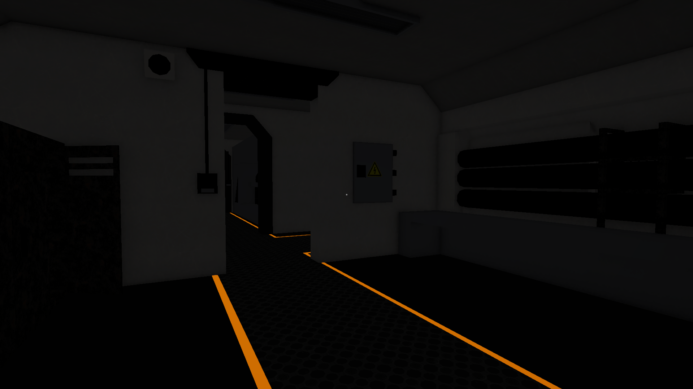
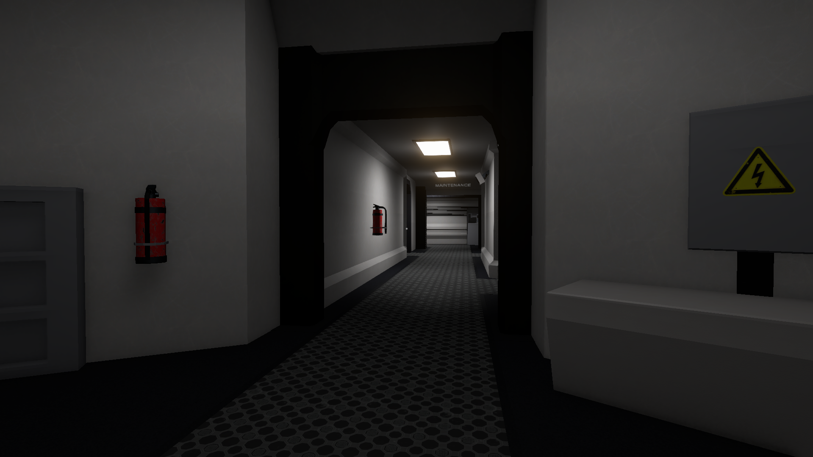

# Distress

A short atmospheric sci-fi experience. After your ship crashes in deep space, you repair damaged modules and uncover what happened aboard and why you're there.

Solo-developed narrative game. Code, ship interior models, lighting and level design from scratch. Third-party assets are listed in [CREDITS.md](CREDITS.md).

_View from the cryo room to the hallway_

_View from the main room to the hallway_

_A demonstration of a repair_

## Download

**Windows** - The game is available to download as a beta release **[here](https://github.com/HollowCreature/distress/releases)**

## What I built

- Modular interaction system for ship module repair minigames, built on interfaces (`IInteractable`, `IFocusInteractable`) and an abstract `RepairTask` base class
- Event system that triggers story/game events on module repair
- Floating-text system to show the player character's thoughts
- Camera-focus system that zooms and locks onto interactable objects for close up interaction
- Full ship interior modelled by hand, with custom lighting and sound design (sound assets from a free library)

## Tech

Unity, C#

## License

Source code is licensed under MIT, see [LICENSE](LICENSE).
Third-party assets (sounds, Asset Store packages) keep their own licenses, see [CREDITS.md](CREDITS.md)
